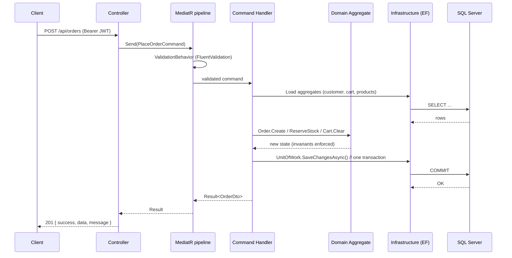
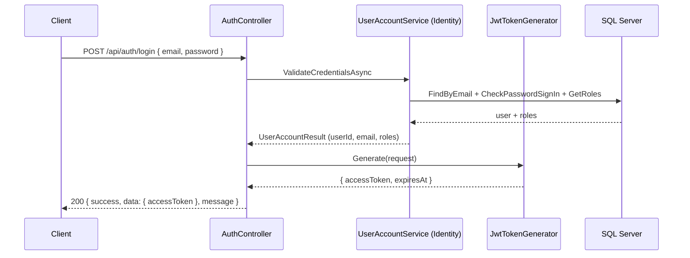
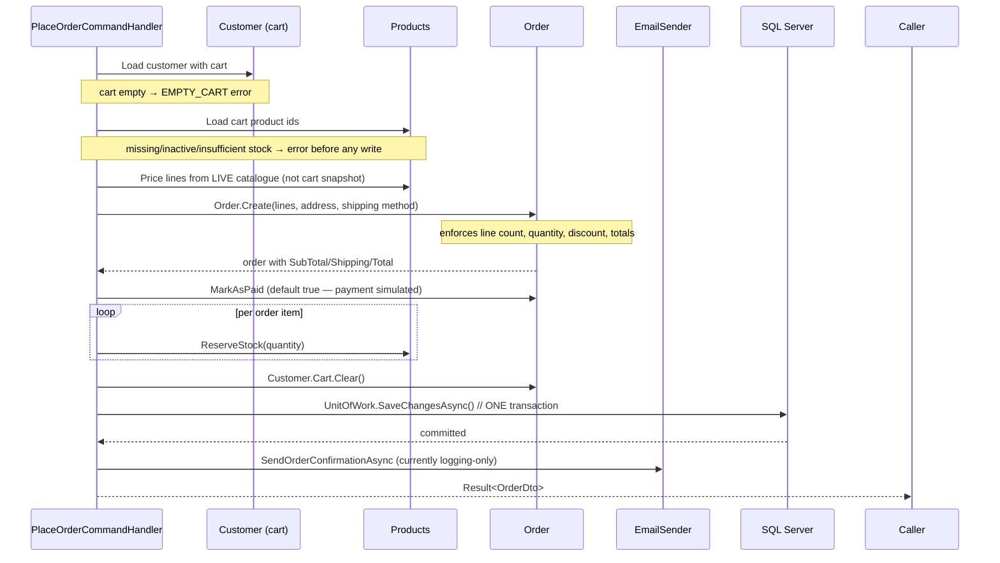
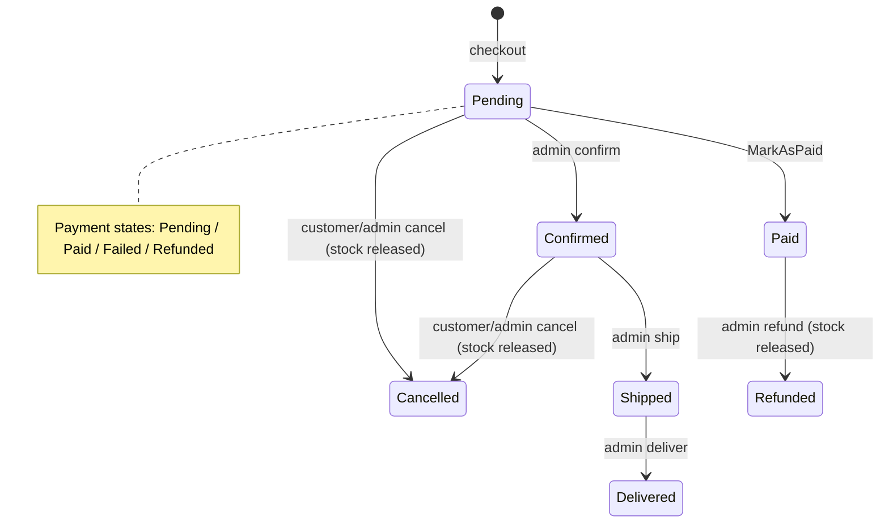
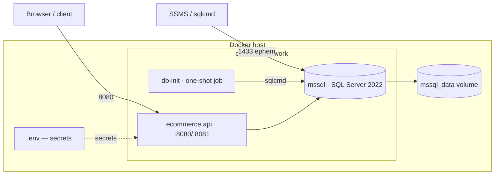

# System Design — E-Commerce API

> A design document describing the architecture, data model, key flows, consistency
> guarantees, deployment topology and evolution roadmap of the E-Commerce API.

---

## 1. Overview

The E-Commerce API is a backend service for an online store built on **.NET 9**.
It exposes a REST API covering customer accounts, product catalogue, shopping cart,
order placement and lifecycle, and product reviews with moderation.

**One-line summary:** a clean-architecture monolith behind a single REST API,
persisted in SQL Server, packaged as Docker containers, with a full automated test
suite (293 tests).

| Aspect | Decision |
| --- | --- |
| Style | Modular monolith, Clean Architecture (onion) layering |
| Communication | Synchronous REST (JSON), Swagger/OpenAPI contract |
| Storage | SQL Server 2022 (single database, EF Core 9) |
| AuthN | ASP.NET Core Identity + JWT bearer tokens (HS256) |
| Concurrency model | Single ACID transaction per command (Unit of Work) |
| Hosting | Docker Compose (API + SQL Server + init job) |

---

## 2. Requirements

### 2.1 Functional

- **Customer accounts** — register, login, change password; customer and admin roles.
- **Catalogue** — categories, products (search, filter, sort, pagination), featured
  products, stock, discounts, low-stock detection.
- **Cart** — one persistent cart per customer; add / update / remove / clear items,
  quantity caps, live pricing.
- **Orders** — checkout from the cart (stock reservation, shipping & totals), customer
  order history, admin status transitions, customer/admin cancellation with stock
  release.
- **Reviews** — customers rate products (1–5), edit, delete; moderation (approve /
  reject) feeding an aggregated product rating.
- **Admin** — manage products, categories, orders, review moderation.

### 2.2 Non-functional

| Requirement | Approach |
| --- | --- |
| Maintainability | Strict layering with inward dependency rule; domain has zero framework dependencies |
| Correctness | Invariants enforced in the domain (aggregate roots), validated again at the edge |
| Consistency | Every command commits in one transaction (save changes through one Unit of Work) |
| Testability | Handlers tested against test doubles; full pipeline tested with `WebApplicationFactory` |
| Security | Passwords hashed by Identity, JWTs signed with a configurable key, least-privilege SQL login |
| Observability | Structured logging behaviors + global exception middleware (future: OpenTelemetry) |
| Operability | Docker Compose with healthchecks and an idempotent DB bootstrap job |

---

## 3. Architecture

### 3.1 Layer diagram

```mermaid
flowchart TB
    Client[Web / Mobile client] -->|HTTPS JSON| Api

    subgraph Api[ECommerce.Api]
        Controllers[Controllers]
        Middleware[Exception Middleware]
        Swagger[Swagger / OpenAPI]
    end

    subgraph Application[ECommerce.Application]
        Handlers[MediatR Command/Query Handlers]
        Behaviors[Validation + Logging + Performance Behaviors]
        Contracts[DTOs, Validators, Result, Errors]
        Interfaces[Ports: repositories, clock, email, JWT]
    end

    subgraph Domain[ECommerce.Domain]
        Aggregates[Order | Product | Cart | Customer | Review]
        ValueObjects[Money, ShippingAddress, OrderNumber, Slug]
        DomainRules[Domain exceptions, invariants]
    end

    subgraph Infrastructure[ECommerce.Infrastructure]
        Ef[EF Core: AppDbContext, EF configurations]
        Adapters[Repositories, UnitOfWork]
        Identity[ASP.NET Identity]
        Jwt[JwtTokenGenerator]
    end

    Db[(SQL Server 2022)]

    Api --> Application
    Application --> Domain
    Infrastructure --> Application
    Infrastructure --> Domain
    Infrastructure --> Db
    Api --> Infrastructure
```

### 3.2 Dependency rule

Dependencies point **inwards**:

- `Api → Application`, `Api → Infrastructure` (composition root only)
- `Infrastructure → Application`, `Infrastructure → Domain`
- `Application → Domain`
- `Domain` depends on nothing.

The Application layer defines **ports** (repository interfaces, `ICurrentUserService`,
`IAccessTokenGenerator`, `IEmailSender`, `IDateTimeProvider`); Infrastructure implements
them. The Domain layer contains the business rules and has no knowledge of EF Core,
ASP.NET Core or JWT.

### 3.3 Why this shape

- Business invariants live once, in the domain, and cannot be bypassed by a future
  controller or background worker.
- The Application layer is testable without a database (pure test doubles).
- EF Core and Identity are replaceable implementation details.
- A modular monolith keeps deployment simple while preserving the option to split
  services later (see §13).

---

## 4. Request lifecycle

A typical authenticated command flows through the pipeline as follows:



- **ValidationBehavior** runs FluentValidation validators before the handler.
- **LoggingBehavior / PerformanceBehavior** trace every command.
- Handlers never call EF directly; they use repository ports and commit through
  `IUnitOfWork`, so a command is **all-or-nothing**.
- Domain exceptions are caught and mapped to typed `Result` errors instead of escaping
  to middleware.

---

## 5. Data model

### 5.1 Entity-relationship diagram

```mermaid
erDiagram
    AspNetUsers ||--o| Customers : "UserId"
    AspNetUsers ||--o{ AspNetUserRoles : ""
    AspNetRoles ||--o{ AspNetUserRoles : ""
    Customers ||--|| Carts : "1:1"
    Carts ||--o{ CartItems : ""
    Products ||--o{ CartItems : ""
    Categories ||--o{ Products : ""
    Products ||--o{ Reviews : ""
    Customers ||--o{ Reviews : ""
    Products ||--o{ OrderItems : ""
    Orders ||--o{ OrderItems : ""
    Customers ||--o{ Orders : ""
    Customers ||--o{ Addresses : ""

    AspNetUsers { guid Id PK }
    AspNetRoles { guid Id PK }
    Customers { guid Id PK, guid UserId FK, string Email, string FullName, bool IsActive }
    Carts { guid Id PK, guid CustomerId FK }
    CartItems { guid Id PK, guid CartId FK, guid ProductId FK, int Quantity, money UnitPrice }
    Categories { guid Id PK, string Name, string Slug, int SortOrder, bool IsDeleted }
    Products { guid Id PK, guid CategoryId FK, string Sku UK, string Name, money Price, money CompareAtPrice, decimal DiscountPercentage, int StockQuantity, int LowStockThreshold, bool IsActive, bool IsFeatured, decimal AverageRating, int ReviewCount, bool IsDeleted }
    Reviews { guid Id PK, guid ProductId FK, guid CustomerId FK, int Rating, bool IsApproved }
    Orders { guid Id PK, guid CustomerId FK, string OrderNumber, int Status, int PaymentStatus, int ShippingMethod, money SubTotal, money DiscountAmount, money ShippingCost, money TotalAmount, datetime OrderDate, bool IsDeleted }
    OrderItems { guid Id PK, guid OrderId FK, guid ProductId FK, string ProductName, string Sku, money UnitPrice, int Quantity }
    Addresses { guid Id PK, guid CustomerId FK, int Type, string RecipientName, string Line1, string Line2, string City, string State, string PostalCode, string Country, bool IsDefault }
```

### 5.2 Key design notes

- **Money** is a value object persisted as `Amount` + `Currency` column pairs
  (decimal `(18,2)`), never a floating-point type.
- **Soft deletes** — every aggregate carries `IsDeleted` (from `Entity` base) and EF
  global query filters hide deleted rows from every query automatically.
- **Cached rating** — `Products.AverageRating / ReviewCount` are denormalised and
  recomputed on review create/edit/reject/approve (see §7.3) to avoid `AVG` per list page.
- **Order snapshot** — order items store the product name/SKU/price at purchase time,
  so the record stays accurate even if the catalogue changes later.
- **Identity schema** lives in the same database (`AppDbContext :
  IdentityDbContext<ApplicationUser, IdentityRole<Guid>, Guid>`), with
  `Customers.UserId` linking the shop profile to the auth account.
- **Indexes** — unique `Sku`; `CategoryId`, `IsActive`, and a composite
  `(CategoryId, IsActive, IsDeleted)` on products; foreign keys on the remaining tables.

### 5.3 Tables (summary)

| Table | Purpose | Owner |
| --- | --- | --- |
| `AspNetUsers`, `AspNetRoles`, `AspNetUserRoles` | Authentication & authorization | Identity |
| `Customers` | Shopper profile + active flag | shop |
| `Addresses` | Stored shipping/billing addresses, default per type | shop |
| `Carts` / `CartItems` | Persistent per-customer cart | shop |
| `Categories` / `Products` | Catalogue with filtering fields | shop |
| `Orders` / `OrderItems` | Orders + purchased-line snapshot | shop |
| `Reviews` | Ratings with moderation flag | shop |

---

## 6. Authentication & authorization

### 6.1 Flow



### 6.2 Token design

- **Algorithm:** HS256 (symmetric key from config, ≥ 32 chars enforced by convention).
- **Claims:** `sub`, `email`, `jti`, `nameidentifier`, `name`, `email`, plus one
  `role` claim per role (`Customer`, `Admin`).
- **Defaults:** issuer `ECommerce.Api`, audience `ECommerce.Clients`, lifetime
  60 minutes. All configurable.
- **Protection:** every shop endpoint is decorated `[Authorize]`; admin-only routes
  require `[Authorize(Roles = "Admin")]`.
- **Identity:** the authenticated user id is surfaced to handlers via
  `ICurrentUserService`, so ownership checks (e.g. "you can only cancel your own
  order") run in the application layer, never by trusting client input.

### 6.3 Roles & permissions

| Role | Capabilities |
| --- | --- |
| `Customer` | Manage own cart/orders, write own reviews |
| `Admin` | CRUD catalogue, order status transitions, review moderation, low-stock/discount management |

> **Known limitation / roadmap:** no refresh tokens yet. Short-lived access tokens
> with re-login on expiry; refresh-token rotation is planned (§13).

---

## 7. Key business flows

### 7.1 Checkout / place order

The most important consistency-critical flow. All of it executes inside **one**
`IUnitOfWork.SaveChangesAsync()` call — i.e. one database transaction.



**Why this is safe:**

- Validation happens **before** any write — an empty cart, inactive product or
  insufficient stock aborts with a typed `Result` and no state change.
- Orders are **priced from the live catalogue**, so a stale cart snapshot can never
  undercharge.
- Stock decrement + order insert + cart clear commit atomically; a crash mid-flight
  leaves no partially-reserved stock.
- Shipping policy: standard free ≥ `$100`, otherwise `$9.99`; express flat `$24.99`.

### 7.2 Order lifecycle



- **Cancellation** is only legal while the order is `Pending` or `Confirmed`
  (still inside the warehouse); both the customer-owner and admins may cancel.
- Cancelling/refunding **releases the reserved stock** back to the catalogue.
- Guardrail duplicates exist in the domain (`CanBeCancelled`) and in the handlers
  (typed `INVALID_ORDER_STATUS_TRANSITION` errors).

### 7.3 Reviews & rating aggregation

Creating, editing, rejecting or approving a review triggers
`ReviewRatingRefresher`, which recomputes `AVG(rating)` over **approved** reviews and
writes the denormalised `AverageRating` / `ReviewCount` back onto the product — in the
same unit of work as the review change, so the cache never drifts:
`Approved? → count → RefreshAsync → product.RecalculateRating → SaveChanges`.

---

## 8. API design

### 8.1 Conventions

- Base path `/api`, Swagger/OpenAPI at `/swagger` (`/swagger/v1/swagger.json`).
- JSON with string enums (`JsonStringEnumConverter`).
- Uniform envelope `{ "success": bool, "data": object?, "message": string? }`.
- Stable, machine-readable error codes.

**Error model:** `ErrorType` → HTTP mapping via `ResultExtensions`:

| `ErrorType` | HTTP | Example code |
| --- | --- | --- |
| Validation | 400 | `VALIDATION_FAILED` |
| Unauthorized | 401 | `INVALID_CREDENTIALS` |
| Forbidden | 403 | `FORBIDDEN` |
| NotFound | 404 | `NOT_FOUND` |
| Conflict | 409 | `INSUFFICIENT_STOCK`, `EMPTY_CART`, `DUPLICATE_SKU`, `ORDER_CANNOT_BE_CANCELLED` |
| Unexpected | 500 | `UNEXPECTED_ERROR` |

### 8.2 Endpoint map

| Area | Endpoints |
| --- | --- |
| Auth | `POST /api/auth/register` · `POST /api/auth/login` · `POST /api/auth/change-password` |
| Products | `GET/POST /api/products` · `GET/PUT/DELETE /api/products/{id}` · `GET /api/products/featured` · `POST /api/products/{id}/stock` · `POST /api/products/{id}/discount` |
| Categories | `GET/POST /api/categories` · `GET/PUT/DELETE /api/categories/{id}` |
| Cart (auth) | `GET /api/cart` · `POST /api/cart/items` · `PUT /api/cart/items/{productId}` · `DELETE /api/cart/items/{productId}` · `DELETE /api/cart` |
| Orders (auth) | `GET/POST /api/orders` · `GET /api/orders/{id}` · `POST /api/orders/{id}/status` (admin) · `POST /api/orders/{id}/cancel` |
| Reviews (auth) | `GET/POST /api/reviews` · `PUT/DELETE /api/reviews/{id}` · `POST /api/reviews/{id}/moderation` (admin) |

**Product list query** supports `search`, `categoryId`, `minPrice`, `maxPrice`,
`inStockOnly`, `featuredOnly`, `activeOnly`, `sortBy` (`name|price|created|rating`),
`sortDescending`, and paging.

---

## 9. Consistency & concurrency

| Concern | Mechanism |
| --- | --- |
| Multi-entity atomicity | One `SaveChanges` per command via `IUnitOfWork` (implicit transaction) |
| Stock integrity | `ReserveStock` inside the checkout transaction; `ReleaseStock` on cancel/refund |
| Rating correctness | Aggregation recomputed in the same transaction as review changes |
| Duplicate SKU / email | Unique DB indexes + validation at the edge |
| Soft delete consistency | Global query filters mean deleted rows never leak into queries |
| Invariant enforcement | Domain aggregates are the only place state transitions are legal |

**Current limits (improvement candidates):**

- **No optimistic concurrency** on `StockQuantity`. Two concurrent checkouts on the
  last unit both pass `HasSufficientStock`, and EF's default last-write-wins could
  momentarily oversell. Mitigate with a `rowversion`/`xmin`-style concurrency token on
  `Products` and retry-on-conflict (see §13).
- **Payment is simulated** via `MarkAsPaid`; a real provider integration would need
  idempotency keys per checkout.
- **Email is logging-only** (`LoggingEmailSender`); a real sender plus an outbox
  pattern is the natural upgrade.

---

## 10. Deployment topology



**Bootstrapping order:**

1. `mssql` starts; healthchecked with `sqlcmd SELECT 1` (via `mssql-tools18`).
2. `db-init` (one-shot) runs `docker/init-db.sql` — idempotently creates the database
   and least-privilege login, then exits.
3. `ecommerce.api` waits for `db-init` to succeed, then boots with the connection
   string and JWT settings injected from `.env` (environment variables override
   appsettings).
4. On startup the API applies EF migrations and seeds the admin account
   (`admin@ecommerce.com` / `Admin!2345` — development only).

**Configuration boundaries:**

| Scope | Values |
| --- | --- |
| `appsettings*.json` | Non-secret defaults only (no connection string, no signing key) |
| `.env` (git-ignored) / `docker-compose` | DB credentials, JWT key, ports |
| User-secrets (local) | Local dev connection string + JWT key |
| Integration tests | In-memory override (SQLite in `WebApplicationFactory`) |

---

## 11. Security

- **Secrets:** never in tracked files — `.env` is git-ignored, `.env.example` is
  committed as a template, and appsettings contain no credentials.
- **Least privilege:** the API connects as an application login (`db_owner` on its own
  DB only), never `sa`.
- **JWT:** HS256-signed, issuer/audience validated, role claims for authorization.
- **Input:** FluentValidation at the edge + domain invariants; SQL via parameterised
  EF LINQ (no string-built SQL).
- **Output:** typed `Result` errors — no stack traces leak (global exception
  middleware maps unexpected errors to `500 UNEXPECTED_ERROR`).
- **Rate limiting / CSRF / CORS:** not yet configured — recommended before public
  exposure (see §13).

---

## 12. Testing strategy

| Layer | Approach | Count |
| --- | --- | --- |
| Domain unit | Aggregate rules: `Money`, `Order` state machine, `Product` stock, `Slug`, `Address`, `Review` | 256 |
| Application unit | Command handlers against test doubles (cart merge, checkout, order lifecycle, auth) | included above |
| Integration | `WebApplicationFactory` boots the **real** API pipeline with SQLite: routing, JWT auth, validation, EF mappings, admin flows, shopping flow | 37 |
| Parity | Identity + EF core also exercised by integration tests | — |

Tests run headless and fast (`dotnet test`, ~17 s).

---

## 13. Scalability & roadmap

**Short term (hardening):**

1. **Optimistic concurrency on `Products.StockQuantity`** — add a concurrency token
   and return `409` + retry, closing the oversell window.
2. **Refresh-token rotation** + revocation endpoint.
3. **Rate limiting** (`AspNetCoreRateLimit` or gateway) and CORS policy.
4. **API versioning** (`/api/v1`) before public consumers exist.
5. **Real email sender** behind `IEmailSender` (SMTP/`SendGrid`), with a **transactional
   outbox** table so order emails are never lost when the DB commits but the SMTP call
   fails.

**Medium term (scale the catalogue without a rewrite):**

6. **Caching layer** — Redis cache-aside for the product list/featured endpoints
   (they are read-heavy and cheap to invalidate on product writes via the existing
   unit-of-work boundaries).
7. **Read/write separation** — move query handlers to a read model / replica, keeping
   the same commands.
8. **Background fulfilment** — an outbox consumer + worker (e.g. `IHostedService`) to
   ship/confirm orders asynchronously instead of admin-initiated transitions.

**When the monolith is ready to split** (high traffic, independent scaling):

9. Extract **Identity**, **Catalogue**, **Orders** as separate services; the existing
   port/adapter seams and aggregate boundaries map cleanly onto service boundaries.
10. Message-driven events (`OrderPlaced`, `StockReserved`, `ReviewApproved`) replace
    direct handler calls; integration tests already simulate the seam.

---

## Appendix — measurements

| Metric | Value |
| --- | --- |
| Commit build (Release) | 0 warnings / 0 errors |
| Automated tests | 293 (256 unit + 37 integration) |
| Compose boot | SQL Server healthy → db-init → API ready |
| Payload contract | `{ success, data, message }` + stable error codes |